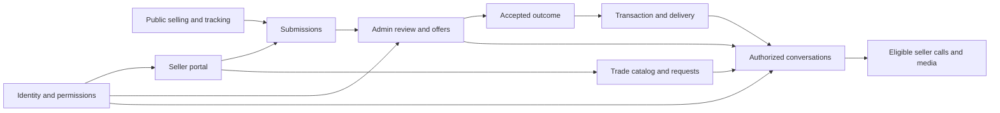

# VNZ-TECH System Map

Source-backed memory ng system, reviewed **2026-11-14**. Ang “implemented” dito ay may existing code path; hiwalay ang tests na pumasa, external configuration, migration application, at actual browser/runtime verification.

## System at a glance

2026-11-19 ID-verification addition: account-once/guest-per-draft ID+selfie/admin-review source and focused checks complete; additive local identity schema/private storage applied. Local activation verified at17:07 after owner Administrator setup: live form/API enabled, private health and daily03 cleanup pass; personal ID/device review pending. Ownership spans Aegis/Forge/Vega, Iris, Orion and Quinn; login upgrade deferred. Current evidence: [[90 System/Runs/2026-11-19 163005 Identity Verification v2]], [[40 Knowledge/Integration Catalog]], [[40 Knowledge/Engineering Lessons]].

PHP/PDO web application para sa scrap-board/whole-phone submissions, offers, transactions, at trade items. May public selling/tracking pages, seller account portal, admin operations, messaging, at supporting identity/notification modules.

- Repository: `C:\xampp\htdocs\VNZ-TECH`
- Obsidian vault: `C:\xampp\htdocs\VNZ-TECH\VNZTECH`
- Baseline source inventory: **186 first-party text/config files**, 115,635 lines scanned for structure; dependencies, uploads, local secrets, and generated vault notes excluded. Later additions are recorded in [[90 System/Coding Updates]].
- Review method: comprehensive file/structure inventory plus targeted reading of core flows, helpers, migrations, tests, and development documentation. This is not a line-by-line correctness audit of every stylesheet or every handler.
- Latest observed commit: `e5728d2` dated **2026-11-13**. Delivery changes are also present as uncommitted working-tree edits.

## Modules and owners

Second-brain operating update **2026-11-19**: the same 20 named owners now have company positions/strategies under [[90 System/Agent Directory]]. The user is CEO/sole final approver; Atlas routes questions/commands to the smallest relevant team. [[90 System/Company Operations]] defines approval and handoffs; [[Task Center]] and [[90 System/Tasks/Current Task]] provide shared checkpoints for this runner/Copilot. This does not re-verify historical PHP module claims below or start autonomous agents.

| Module | Agent | Evidence status |
| --- | --- | --- |
| [[40 Knowledge/System Modules/Identity and Accounts|Identity and Accounts]] | [[90 System/Agents/Aegis|Aegis]] | Ownership/onboarding tests + 14 remember-login HTTP cases pass |
| [[40 Knowledge/System Modules/Social Login|Social Login]] | [[90 System/Agents/Cipher|Cipher]] | Source + helper pass + setup-check failure |
| [[40 Knowledge/System Modules/Messaging and Moderation|Messaging and Moderation]] | [[90 System/Agents/Echo|Echo]] | Source + moderation-helper pass |
| [[40 Knowledge/System Modules/Calls and Media|Calls and Media]] | [[90 System/Agents/Lyra|Lyra]] | Source + attachment-helper pass |
| [[40 Knowledge/System Modules/Submissions and Offers|Submissions and Offers]] | [[90 System/Agents/Orion|Orion]] | Source + ownership/guest-link/onboarding pass; popup added |
| [[40 Knowledge/System Modules/Transactions and Delivery|Transactions and Delivery]] | [[90 System/Agents/Mira|Mira]] | Source + passing helper test; uncommitted |
| [[40 Knowledge/System Modules/Trades and Catalog|Trades and Catalog]] | [[90 System/Agents/Flint|Flint]] | Source reviewed; runtime unverified |
| [[40 Knowledge/System Modules/Buying Rates|Buying Rates]] | [[90 System/Agents/Peso|Peso]] | Source reviewed; runtime unverified |
| [[40 Knowledge/System Modules/Admin Operations and Reports|Admin Operations and Reports]] | [[90 System/Agents/Rhea|Rhea]] | Source reviewed; runtime unverified |
| [[40 Knowledge/System Modules/Email and Notifications|Email and Notifications]] | [[90 System/Agents/Beacon|Beacon]] | Source reviewed; runtime unverified |
| [[40 Knowledge/System Modules/Data and Migrations|Data and Migrations]] | [[90 System/Agents/Vega|Vega]] | Local remember-token migration applied; other deployment state unverified |
| [[40 Knowledge/System Modules/Interface and Portal UX|Interface and Portal UX]] | [[90 System/Agents/Iris|Iris]] | Claim/approval/dialog fixtures pass; active light/dark theme required |
| [[40 Knowledge/System Modules/Backend Architecture|Backend Architecture]] | [[90 System/Agents/Forge|Forge]] | Source reviewed; runtime unverified |
| [[40 Knowledge/System Modules/Verification and QA|Verification and QA]] | [[90 System/Agents/Quinn|Quinn]] | Baseline retained; guest fixture fixed + focused new checks pass |

## Main flow

## Current verification

The [[50 Reviews/VNZ-TECH Implementation Snapshot 2026-11-14|baseline snapshot]] records five passing checks, two failures, and one unrun test. A later claim-popup task corrected the guest-link fixture and passed all eight existing cases, new onboarding helper checks, offer authorization, syntax checks, and a real dialog/assets browser test with mocked email/status APIs. Live SMTP and signup/token completion remain unverified. Details: [[90 System/Runs/2026-11-14 041934 Guest Submission Claim Popup]].

A subsequent verification-feedback fix adds ten passing HTTP cases against actual PHP routes with fake SQLite/session boundaries, covering verification, token consumption, guest linking, invalid links, and trusted feedback. The browser check now covers reopening after dismissal and portal-refresh events. Live SMTP/fresh signup and mobile checks remain separate gaps. Latest: [[90 System/Runs/2026-11-14 044636 Email Verification Feedback]].

The Remember me repair applied the previously missing local token-table migration, passed 14 isolated login/remember HTTP cases and a rolled-back MySQL token-storage check, and verified shared-dialog themes in 12 Chrome fixture cases. All future UI changes must follow the active light/dark theme, per the user's explicit requirement. Latest: [[90 System/Runs/2026-11-14 050800 Remember Login and Theme Consistency]].

## Open questions worth retaining

- Guest-link fixture issue is resolved in the latest focused run; live email-to-claim completion still needs separate verification.
- Social-login setup source-safety assertion expects placeholders absent from the script; a dedicated review should reconcile intended setup behavior with its test.
- Direct submission acceptance documents an `offer_id = NULL` schema-compatibility concern; the live schema remains unverified.
- Recent OAuth/delivery migration application and provider/runtime configuration are not established by this review.
- Live browser flows, SMTP, realtime connections, calls/media, and full transaction integration still need dedicated verification.

[[90 System/Agent Directory]] · [[30 Resources/VNZ-TECH Source Inventory]] · [[50 Reviews/VNZ-TECH Implementation Snapshot 2026-11-14]] · [[Home]]

## Current submission face flow - 2026-11-19 21:53

Local v6 replaces ID enrollment/admin review with submit-time private selfie and a local one-face check for each guest/account submission. The photo lives inside existing admin submission details under view_submissions; no new admin module or external matching service. Additive photo table/terminal trigger applied, existing daily cleanup reused, live guest/token/retired-ID probes pass. Owner camera/device acceptance remains pending. [[90 System/Runs/2026-11-19 213300 Submission Selfie v6]]
