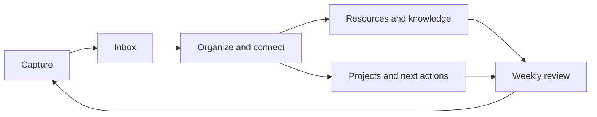

# VNZTECH Second Brain

> [!tip] Start small
> Capture mo muna ang idea. Saka natin linawin, iugnay, at gawing next action.

**System memory:** [[40 Knowledge/VNZ-TECH System Map]] · [[90 System/Agent Directory]] · [[50 Reviews/VNZ-TECH Implementation Snapshot 2026-11-14]]

**Unang gamit:** [[90 System/Start Here|Start Here]] · **Mga prompt:** [[90 System/Workflows|Workflows]]

> [!tip] Automatic coding memory
> Pagkatapos ng coding task na ipagawa mo rito, kasama nang i-update ang relevant notes at [[90 System/Coding Updates|Coding Updates]]. Hindi na kailangang ulitin ang “update Obsidian.” Ang direct manual VS Code edits ay hindi pa mino-monitor.

## Quick access

| Gusto mong gawin | Buksan |
| --- | --- |
| Mag-save ng idea o task | [[01 Inbox/Inbox|Inbox]] |
| Tingnan ang initial daily note | [[02 Daily/2026-11-14|14 November 2026]] |
| Tingnan ang mga project | [[10 Projects/Projects|Projects]] |
| Alagaan ang ongoing responsibilities | [[20 Areas/Areas|Areas]] |
| Balikan ang research at references | [[30 Resources/Resources|Resources]] |
| Hanapin ang distilled learnings | [[40 Knowledge/Knowledge|Knowledge]] |
| Mag-review ng progress | [[50 Reviews/Reviews|Reviews]] |
| Balikan ang inactive material | [[99 Archive/Archive|Archive]] |

Para sa daily note ng kasalukuyang araw: `Ctrl+P` → **Daily notes: Open today's daily note**.

## Agent team

| Agent | Role | Trabaho | Halimbawa ng request dito sa chat |
| --- | --- | --- | --- |
| [[90 System/Agents/Atlas|Atlas]] | Orchestrator | Pumili at mag-coordinate ng roles | “Atlas, ayusin natin ang second brain ko.” |
| [[90 System/Agents/Tala|Tala]] | Capture | I-save ang ideas at raw input | “Tala, capture mo itong idea…” |
| [[90 System/Agents/Lex|Lex]] | Librarian | Organize, connect, at distill notes | “Lex, i-process ang inbox ko.” |
| [[90 System/Agents/Nova|Nova]] | Researcher | Research na may sources | “Nova, research natin kung paano…” |
| [[90 System/Agents/Kai|Kai]] | Planner | Outcomes, projects, at next actions | “Kai, gawan mo ng plan ito.” |
| [[90 System/Agents/Sage|Sage]] | Reviewer | Progress, blockers, at reviews | “Sage, review natin ang linggo ko.” |

## VNZ-TECH specialist team

**14 bagong specialists; 20 agents lahat.** Bawat specialist ay naka-link sa actual source paths at module memory.

| Agent | Sakop | Context |
| --- | --- | --- |
| [[90 System/Agents/Aegis|Aegis]] | Seller/admin login, permissions, sessions, recovery, at 2FA | [[40 Knowledge/System Modules/Identity and Accounts|Identity and Accounts]] |
| [[90 System/Agents/Cipher|Cipher]] | Google/Facebook OAuth at social signup | [[40 Knowledge/System Modules/Social Login|Social Login]] |
| [[90 System/Agents/Echo|Echo]] | Conversations, realtime messaging, presence, reactions, at moderation | [[40 Knowledge/System Modules/Messaging and Moderation|Messaging and Moderation]] |
| [[90 System/Agents/Lyra|Lyra]] | Seller calls, WebRTC signaling, voice/video, at attachments | [[40 Knowledge/System Modules/Calls and Media|Calls and Media]] |
| [[90 System/Agents/Orion|Orion]] | Scrap submissions, tracking, offers, counter-offers, at guest claims | [[40 Knowledge/System Modules/Submissions and Offers|Submissions and Offers]] |
| [[90 System/Agents/Mira|Mira]] | Transaction lifecycle, seller delivery proposal, at admin confirmation | [[40 Knowledge/System Modules/Transactions and Delivery|Transactions and Delivery]] |
| [[90 System/Agents/Flint|Flint]] | Trade items, requirements, requests, at status transitions | [[40 Knowledge/System Modules/Trades and Catalog|Trades and Catalog]] |
| [[90 System/Agents/Peso|Peso]] | Rate management, archive/restore, at public pricing references | [[40 Knowledge/System Modules/Buying Rates|Buying Rates]] |
| [[90 System/Agents/Rhea|Rhea]] | Admin dashboards, permissions, activity logs, reports, at CSV export | [[40 Knowledge/System Modules/Admin Operations and Reports|Admin Operations and Reports]] |
| [[90 System/Agents/Beacon|Beacon]] | Email verification, SMTP integration points, preferences, at notification badges | [[40 Knowledge/System Modules/Email and Notifications|Email and Notifications]] |
| [[90 System/Agents/Vega|Vega]] | Schema relationships, migrations, indexes, at state compatibility | [[40 Knowledge/System Modules/Data and Migrations|Data and Migrations]] |
| [[90 System/Agents/Iris|Iris]] | Public/seller/admin interfaces, themes, language, dialogs, at loading states | [[40 Knowledge/System Modules/Interface and Portal UX|Interface and Portal UX]] |
| [[90 System/Agents/Forge|Forge]] | PHP endpoint structure, shared helpers, API contracts, at cross-module flow | [[40 Knowledge/System Modules/Backend Architecture|Backend Architecture]] |
| [[90 System/Agents/Quinn|Quinn]] | Test coverage, regressions, verification evidence, at source/runtime distinctions | [[40 Knowledge/System Modules/Verification and QA|Verification and QA]] |

> [!info] Implementation snapshot — 2026-11-14
> Baseline source/config inventory: **186 files, 27 migrations**; checks: **5 pass, 2 fail, 1 not run**. Nasa [[50 Reviews/VNZ-TECH Implementation Snapshot 2026-11-14]] ang historical evidence. Later work: guest-claim popup implemented, guest-link fixture corrected, at focused checks pass; tingnan ang [[90 System/Coding Updates]] para sa latest results at limits.

Puwede silang tawagin sa **pangalan o role**; halimbawa, `Tala: [idea]` o `Capture: [idea]`.

May repository-root `AGENTS.md` na nagtuturo sa assistant na gamitin ang vault conventions at i-update ang Obsidian pagkatapos ng coding tasks. Nasa [[90 System/Workflows|Workflows]] ang optional explicit prompts para sa specific roles.

## Simple flow

## Setup at habits

- [[10 Projects/Second Brain Setup|Second Brain Setup]] — subukan ang unang capture at workflow.
- [[20 Areas/Knowledge Management|Knowledge Management]] — simpleng daily at weekly habits.
- [[90 System/Runs/Agent Runs|Agent Runs]] — tala ng substantive agent work.
- [[90 System/Start Here#Templates at daily notes|Templates at daily notes]] — settings at paggamit.

> [!info] Paano gumagana ang agents
> Obsidian ang notes interface; ang AI runner na may access sa vault, gaya ng chat na ito, ang nagbabasa ng role instructions at gumagawa ng notes kapag inutusan mo.
