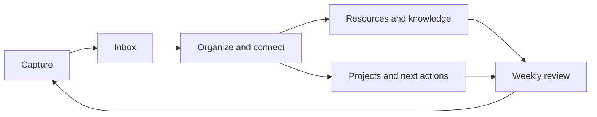

# VNZTECH Second Brain

> [!tip] Start small
> Capture mo muna ang idea. Saka natin linawin, iugnay, at gawing next action.

**System memory:** [[40 Knowledge/VNZ-TECH System Map]] · [[90 System/Agent Directory]] · [[50 Reviews/VNZ-TECH Implementation Snapshot 2026-11-14]]

**Unang gamit:** [[90 System/Start Here|Start Here]] · **Mga prompt:** [[90 System/Workflows|Workflows]]

> [!tip] Agent Office
> May company office na para sa 20 agents: [[Agent Office|guide at preview]]. Ikaw ang CEO/final approver; dito sa chat ka mag-uutos at si Atlas ang magro-route ng team. Pag enabled na: **Ctrl+P → Open Agent Office**. I-off/on ang plugin para ma-load ang updated company/task view.

**Work desk:** [[Task Center]] · [[90 System/Tasks/Current Task|Current Task / saan huminto]] · [[Approval Inbox]] · [[Decision Log]] · [[90 System/Company Operations|Company workflow]]

**Mas tipid na agent workflow:** [[90 System/Ponytail|Ponytail]] — relevant notes lang muna, reuse ng existing setup, at concise updates. Default sa vault guidance; actual token savings depend sa task at runner.

> [!tip] Automatic coding memory
> Pagkatapos ng coding task na ipagawa mo rito, kasama nang i-update ang relevant notes at [[90 System/Coding Updates|Coding Updates]]. Hindi na kailangang ulitin ang “update Obsidian.” Ang direct manual VS Code edits ay hindi pa mino-monitor.

## Quick access

| Gusto mong gawin | Buksan |
| --- | --- |
| Balikan ang current/last task at checkpoint | [[90 System/Tasks/Current Task|Current Task]] |
| Review ng lahat ng recorded tasks | [[Task Center]] |
| Mga naghihintay ng decision mo | [[Approval Inbox]] |
| Mag-save ng idea o task | [[01 Inbox/Inbox|Inbox]] |
| Tingnan ang initial daily note | [[02 Daily/2026-11-14|14 November 2026]] |
| Tingnan ang mga project | [[10 Projects/Projects|Projects]] |
| Alagaan ang ongoing responsibilities | [[20 Areas/Areas|Areas]] |
| Balikan ang research at references | [[30 Resources/Resources|Resources]] |
| Hanapin ang distilled learnings | [[40 Knowledge/Knowledge|Knowledge]] |
| Mag-review ng progress | [[50 Reviews/Reviews|Reviews]] |
| Balikan ang inactive material | [[99 Archive/Archive|Archive]] |

Para sa daily note ng kasalukuyang araw: `Ctrl+P` → **Daily notes: Open today's daily note**.

## Agent team

| Agent | Role | Trabaho | Halimbawa ng request dito sa chat |
| --- | --- | --- | --- |
| [[90 System/Agents/Atlas|Atlas]] | Delivery Director | Pumili at mag-coordinate ng roles | “Atlas, ayusin natin ang second brain ko.” |
| [[90 System/Agents/Tala|Tala]] | Business Intake Coordinator | I-save ang ideas at raw input | “Tala, capture mo itong idea…” |
| [[90 System/Agents/Lex|Lex]] | Knowledge & Documentation Lead | Organize, connect, at distill notes | “Lex, i-process ang inbox ko.” |
| [[90 System/Agents/Nova|Nova]] | Research Lead | Research na may sources | “Nova, research natin kung paano…” |
| [[90 System/Agents/Kai|Kai]] | Lead Systems Analyst | Outcomes, projects, at next actions | “Kai, gawan mo ng plan ito.” |
| [[90 System/Agents/Sage|Sage]] | Governance & Release Reviewer | Progress, blockers, at reviews | “Sage, review natin ang linggo ko.” |

## VNZ-TECH specialist team

**20 agents, anim na company departments.** Positions/strategies are in [[90 System/Agent Directory]]; existing module specialties below remain intact. [[90 System/Company Operations|Owner approval and routing]] applies to every role.

| Agent | Position | Module context |
| --- | --- | --- |
| [[90 System/Agents/Aegis|Aegis]] | Security & Identity Lead | [[40 Knowledge/System Modules/Identity and Accounts|Identity and Accounts]] |
| [[90 System/Agents/Cipher|Cipher]] | Authentication Engineer | [[40 Knowledge/System Modules/Social Login|Social Login]] |
| [[90 System/Agents/Echo|Echo]] | Backend & Messaging Engineer | [[40 Knowledge/System Modules/Messaging and Moderation|Messaging and Moderation]] |
| [[90 System/Agents/Lyra|Lyra]] | Realtime & Media Engineer | [[40 Knowledge/System Modules/Calls and Media|Calls and Media]] |
| [[90 System/Agents/Orion|Orion]] | Seller Experience Analyst | [[40 Knowledge/System Modules/Submissions and Offers|Submissions and Offers]] |
| [[90 System/Agents/Mira|Mira]] | Business Process Analyst | [[40 Knowledge/System Modules/Transactions and Delivery|Transactions and Delivery]] |
| [[90 System/Agents/Flint|Flint]] | Trade Product Analyst | [[40 Knowledge/System Modules/Trades and Catalog|Trades and Catalog]] |
| [[90 System/Agents/Peso|Peso]] | Pricing & Business Intelligence Analyst | [[40 Knowledge/System Modules/Buying Rates|Buying Rates]] |
| [[90 System/Agents/Rhea|Rhea]] | IT Operations & Change Manager | [[40 Knowledge/System Modules/Admin Operations and Reports|Admin Operations and Reports]] |
| [[90 System/Agents/Beacon|Beacon]] | Integration & Notifications Engineer | [[40 Knowledge/System Modules/Email and Notifications|Email and Notifications]] |
| [[90 System/Agents/Vega|Vega]] | Database Engineer | [[40 Knowledge/System Modules/Data and Migrations|Data and Migrations]] |
| [[90 System/Agents/Iris|Iris]] | Product Designer & Frontend Lead | [[40 Knowledge/System Modules/Interface and Portal UX|Interface and Portal UX]] |
| [[90 System/Agents/Forge|Forge]] | Software Architect & Engineering Lead | [[40 Knowledge/System Modules/Backend Architecture|Backend Architecture]] |
| [[90 System/Agents/Quinn|Quinn]] | QA & Test Engineering Lead | [[40 Knowledge/System Modules/Verification and QA|Verification and QA]] |

> [!info] Implementation snapshot — 2026-11-14
> Baseline source/config inventory: **186 files, 27 migrations**; checks: **5 pass, 2 fail, 1 not run**. Nasa [[50 Reviews/VNZ-TECH Implementation Snapshot 2026-11-14]] ang historical evidence. Later work: guest-claim popup implemented, guest-link fixture corrected, at focused checks pass; tingnan ang [[90 System/Coding Updates]] para sa latest results at limits.

Puwede silang tawagin sa **pangalan o role**; halimbawa, `Tala: [idea]` o `Capture: [idea]`.

May repository-root `AGENTS.md` na nagtuturo sa assistant na gamitin ang vault conventions at i-update ang Obsidian pagkatapos ng coding tasks. Nasa [[90 System/Workflows|Workflows]] ang optional explicit prompts para sa specific roles.

## Simple flow

## Setup at habits

- [[10 Projects/Second Brain Setup|Second Brain Setup]] — subukan ang unang capture at workflow.
- [[20 Areas/Knowledge Management|Knowledge Management]] — simpleng daily at weekly habits.
- [[90 System/Runs/Agent Runs|Agent Runs]] — tala ng substantive agent work.
- [[90 System/Start Here#Templates at daily notes|Templates at daily notes]] — settings at paggamit.

> [!info] Paano gumagana ang agents
> Obsidian ang notes interface; ang AI runner na may access sa vault, gaya ng chat na ito, ang nagbabasa ng role instructions at gumagawa ng notes kapag inutusan mo.
